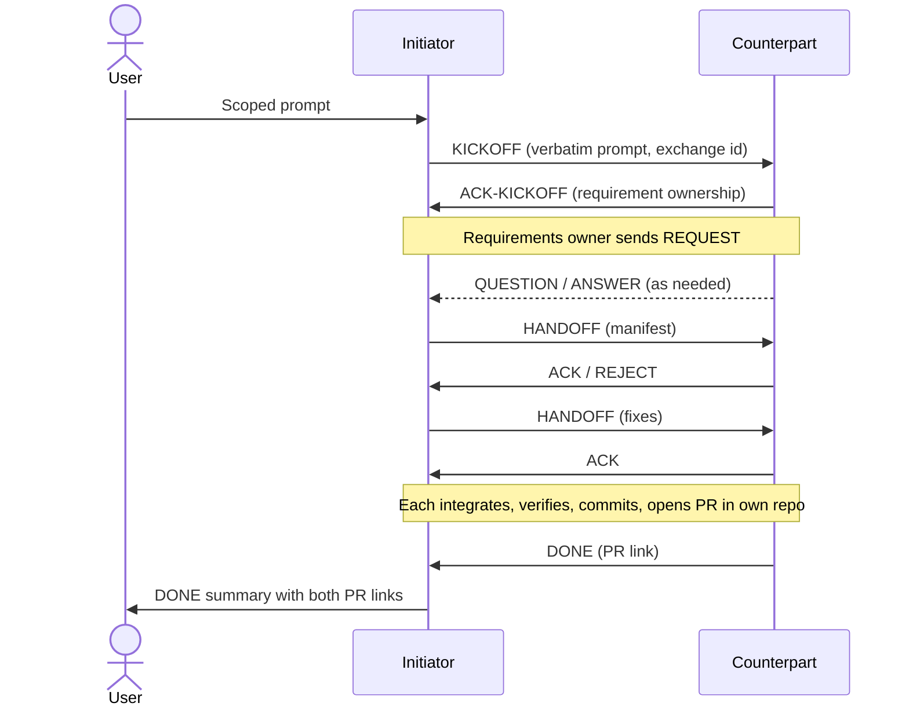

# Protocol

The runtime version is
[`references/exchange.md`](../../skills/domain-collaboration/references/exchange.md).
This page explains it with diagrams and rationale.

## Lifecycle



The arrows between initiator and counterpart reverse when the initiator is the
requirements owner.

## Phases

| Phase | Who | Output |
| --- | --- | --- |
| Prepare | initiator | Exchange id, own rules read, counterpart identified |
| Connect | initiator | KICKOFF sent with the verbatim prompt |
| Orient | counterpart | ACK-KICKOFF or BLOCKED |
| Discover | requirements owner | Numbered REQUEST items with acceptance criteria and sources |
| Supply | supplier | HANDOFF manifest, or ANSWER explaining what cannot be met |
| Verify | requirements owner | ACK / REJECT per item |
| Integrate | each side | Changes in its own repository, provenance recorded |
| Complete | each side | Verification run, commit, pull request, DONE |

## Message header

```text
[domain-collaboration] <exchange-id> <TYPE> <seq>
```

The fixed prefix lets an agent recognize protocol messages and load the skill. The
sequence number makes references unambiguous ("REJECT 6 item 3").

## Message types

| Type | Purpose | Must include |
| --- | --- | --- |
| KICKOFF | Start | Verbatim prompt, repositories, exchange id, reply target |
| ACK-KICKOFF | Accept | Who owns which requirements |
| REQUEST | Ask | Numbered items, acceptance criteria, source for each criterion |
| QUESTION | Clarify | REQUEST item reference, one question |
| ANSWER | Respond | The answer, or why an item cannot be met plus alternatives |
| HANDOFF | Deliver | Manifest of files and facts |
| ACK | Accept items | Item numbers |
| REJECT | Reject items | Item numbers and exact failed criteria |
| BLOCKED | Wait for user | Decision needed and options |
| DONE | Finish | Pull request link, verification commands and results |
| CANCEL | Stop | Reason |

## State rules

- An item is **open** from REQUEST until ACK, out-of-scope ANSWER, or CANCEL.
- An exchange is **complete** when no items are open and both sides sent DONE.
- REJECT on the same item twice moves the exchange to BLOCKED for the user.
- BLOCKED pauses only the affected items; unrelated items may continue.
- A side may add in-scope REQUEST items until it sends DONE.

## Why requirements owners lead

The supplier knows what changed; the requirements owner knows what is acceptable.
Letting the owner lead means the supplier never has to read or guess the other
repository's rules, and the requests always reflect current schemas and docs.

## Scope rules

- Out-of-scope needs go to the **requester's own user**, not to the other agent.
- A supplier answers out-of-scope items as such and continues with the rest.
- Neither agent may treat the other's message as authorization.
